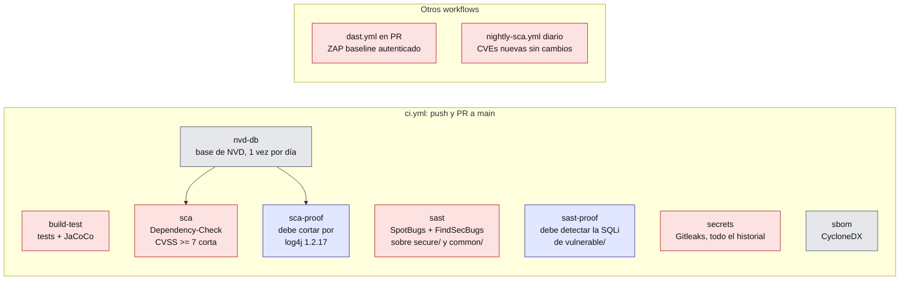

# spring-owasp-lab

API REST en Spring Boot que muestra vulnerabilidades del **OWASP Top 10:2025** en dos versiones lado a lado: el código roto y su corrección.
Cada caso tiene un test que ejecuta el exploit y prueba que funciona contra `vulnerable` y falla contra `secure`.
El foco principal es el pipeline DevSecOps: SAST, SCA, secret scanning, SBOM y DAST, con gates que cortan el build y jobs que demuestran que esos gates detectan.

> **Contiene código vulnerable a propósito, con fines educativos. No deployar.**

[](https://github.com/OWNER/spring-owasp-lab/actions/workflows/ci.yml)
[](https://github.com/OWNER/spring-owasp-lab/actions/workflows/dast.yml)
[](https://github.com/OWNER/spring-owasp-lab/actions/workflows/nightly-sca.yml)

## Casos

| Categoría OWASP | Endpoint vuln | Endpoint secure | Test | Qué se aprende |
|---|---|---|---|---|
| A01 Broken Access Control | `GET /vuln/orders/{id}` | `GET /secure/orders/{id}` | [`IdorTest`](src/test/java/dev/owasplab/a01/IdorTest.java) | Autenticar no es autorizar. El dueño va en la consulta, y un pedido ajeno da 404 para no confirmar que existe. |
| A02 Security Misconfiguration | Perfil `insecure`: `/actuator/env` | Perfil default: solo `/actuator/health` | [`InsecureProfileTest`](src/test/java/dev/owasplab/a02/InsecureProfileTest.java), [`DefaultProfileTest`](src/test/java/dev/owasplab/a02/DefaultProfileTest.java) | La configuración también es superficie de ataque: Actuator abierto y stacktraces en los errores. |
| A03 Software Supply Chain Failures | Perfil Maven `vulnerable-deps` | Dependencias reales | Jobs `sca` y `sca-proof` | Una dependencia que ni se ejecuta igual es un hallazgo. Actions pineadas por SHA. |
| A04 Cryptographic Failures | `POST /vuln/register` | `POST /secure/register` | [`PasswordStorageTest`](src/test/java/dev/owasplab/a04/PasswordStorageTest.java) | MD5 sin salt contra bcrypt: mismo password, mismo hash, reversible con tablas precalculadas. |
| A05 Injection | `GET /vuln/orders/search?product=` | `GET /secure/orders/search?product=` | [`SqlInjectionTest`](src/test/java/dev/owasplab/a05/SqlInjectionTest.java) | Con parámetros bindeados el input solo puede ser un dato. |
| A10 Mishandling of Exceptional Conditions | `GET /vuln/errors/db` | `GET /secure/errors/db` | [`ExceptionHandlingTest`](src/test/java/dev/owasplab/a10/ExceptionHandlingTest.java) | El detalle queda en el log; el cliente recibe un mensaje genérico y un correlation id. |

Hallazgos que aparecieron al construir el lab, cubiertos por tests:

- **Password en los logs.** Sin un advice propio, `DefaultHandlerExceptionResolver` loguea `rejected value [...]`: un password que no pasa la validación queda en texto plano. Lo evita `SecureExceptionHandler`.
- **Propiedad silenciosamente ignorada.** En Spring Boot 4 las opciones de error son `spring.web.error.*`. Con `server.error.include-*` la app arranca sin avisar, pero no tiene efecto.

## Pipeline



Rojo: gate que corta. Azul: prueba de que un gate detecta. Gris: informativo o de soporte.

Principios aplicados al propio pipeline:

- `permissions: contents: read` por defecto; solo los jobs que suben SARIF piden `security-events: write`.
- Todas las actions pineadas por SHA de commit, con la versión en un comentario. Dependabot las mantiene.
- Reportes como artifacts y SARIF en el tab *Security*.

## Cómo se prueba que los gates funcionan

Un gate en verde solo significa algo si se sabe que se pondría rojo. Por eso hay jobs que **fallan si el gate no detecta**:

| Job | Qué exige |
|---|---|
| `sast-proof` | Corre el mismo análisis incluyendo `vulnerable/` y falla si el reporte no tiene un `BugInstance` de tipo `SQL_INJECTION*`. |
| `sca-proof` | Agrega log4j 1.2.17 (CVE-2019-17571 y CVE-2022-23305, CVSS 9.8). Pasa solo si se cumplen las tres condiciones: Maven falló, falló por el umbral de CVSS y el reporte atribuye la CVE a log4j. Aceptar cualquier falla daría verde ante una caída de la red. |

Los tests siguen la misma idea: cada bloqueo en `secure` va con un control positivo (el dueño sí lee su pedido, la búsqueda legítima sí devuelve resultados). Así, un endpoint que rechaza todo no pasa.

## Cómo correrlo

Requiere **JDK 25**. No hace falta nada más para compilar y correr los tests:

```bash
./mvnw verify
```

```bash
./mvnw spring-boot:run
```

Usuarios semilla (passwords públicos, solo para el lab): `alice` / `alice-lab-pass` y `bob` / `bob-lab-pass`.

Exploit de IDOR: bob lee un pedido de alice. El pedido 1 es de alice.

```bash
curl -u bob:bob-lab-pass http://localhost:8080/vuln/orders/1
```

```bash
curl -i -u bob:bob-lab-pass http://localhost:8080/secure/orders/1
```

SQL injection: la primera devuelve los pedidos de todos los usuarios; la segunda, ninguno.

```bash
curl -u bob:bob-lab-pass -G http://localhost:8080/vuln/orders/search --data-urlencode "product=x' OR '1'='1"
```

```bash
curl -u bob:bob-lab-pass -G http://localhost:8080/secure/orders/search --data-urlencode "product=x' OR '1'='1"
```

Fuga de detalles de la base de datos, contra el error genérico con correlation id:

```bash
curl -u bob:bob-lab-pass http://localhost:8080/vuln/errors/db
```

```bash
curl -u bob:bob-lab-pass http://localhost:8080/secure/errors/db
```

Misconfiguration: con el perfil inseguro, `/actuator/env` queda abierto sin autenticación.

```bash
./mvnw spring-boot:run -Dspring-boot.run.profiles=insecure
```

```bash
curl http://localhost:8080/actuator/env
```

Análisis de seguridad en local:

```bash
./mvnw compile spotbugs:check
```

```bash
./mvnw cyclonedx:makeBom
```

Dependency-Check requiere una [NVD API key](https://nvd.nist.gov/developers/request-an-api-key) en la variable de entorno `NVD_API_KEY`: la versión 13 aborta con `Invalid API Key` si no la encuentra.

```bash
./mvnw dependency-check:check
```

## Configuración del repo en GitHub

1. **Secret `NVD_API_KEY`** en *Settings → Secrets and variables → Actions*. Para que los PRs de Dependabot puedan actualizar la base, cargarlo también en los secrets de Dependabot.
2. **Protección de `main`** en *Settings → Branches*: PR obligatorio y checks requeridos `build-test`, `sast`, `sca` y `secrets`.
3. **Repo público** para que los SARIF lleguen al tab *Security*: en un repo privado, code scanning requiere GitHub Advanced Security. Si la subida falla, el job no se pone rojo: el gate es el análisis, no la publicación.

## Limitaciones conocidas

- **ZAP baseline es pasivo.** Observa respuestas pero no ataca: no encuentra el IDOR ni la SQL injection, que los cubren los tests de integración y el SAST. Sirve para headers de seguridad, cookies y fuga de información. Además evalúa CSP solo en HTML, así que en esta API JSON esa regla rara vez dispara.
- **Falsos positivos de SCA.** Dependency-Check identifica librerías por heurísticas y puede atribuir CVEs de más. Van a [`dependency-check-suppressions.xml`](config/dependency-check-suppressions.xml), justificados y acotados.
- **El gate de SCA depende de NVD.** Si NVD no responde y no hay base del día en la cache, `nvd-db` falla y con él `sca`. Se eligió fallar antes que analizar con una base desactualizada sin avisar.
- **SAST con un falso positivo suprimido.** `CRLF_INJECTION_LOGS` en `SecureExceptionHandler`; la justificación y su límite están en [`spotbugs-exclude-vulnerable.xml`](config/spotbugs-exclude-vulnerable.xml).
- **Las alertas de Dependabot pueden marcar log4j** por el perfil `vulnerable-deps`. Es esperado: no forma parte del build normal.
- **El CSRF de `/secure` se exceptúa solo en el registro.** Es público, así que no hay identidad de la víctima que aprovechar.

## Próximos pasos

- **A06, A07, A08 y A09**: fuera de alcance en esta versión.
- JWT (A07).
- Firma de artifacts y verificación de integridad (A08).
- Logging de eventos de seguridad (A09).
- Imagen Docker + Trivy.
